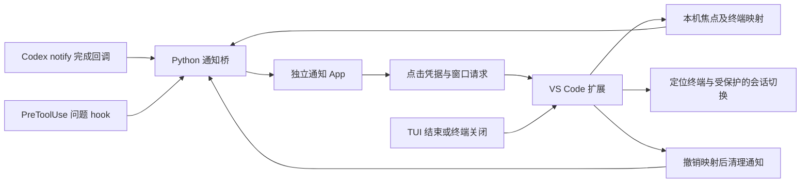

# 工作原理与边界

## 数据流

完成回调继续转发安装前已有的命令。桥接命令、问题 hook 和清理命令不会转发给原回调。问题 hook 从输入中的 `questions` 统计数量；不把问题正文显示在系统通知。

## 识别与焦点

安装设置 `terminal_title = ["app-name", "thread-id", "thread-name"]`。扩展使用稳定的 shell integration 输出流观察 OSC 0/2 标题；Codex 截短的 ID 通过本机会话索引和只读数据库解析，歧义时不猜测。VS Code 终端名称只是后备来源。

前台定义为本地 VS Code 窗口有焦点，且目标会话位于当前选中终端。焦点转到同窗口编辑器仍视为前台。扩展每秒发布状态，超过 3 秒或进程不存在就失效。未知身份继续通知。

## 退出清理

每次 shell 命令独立记录观察过的会话。稳定的命令结束和终端关闭事件进入同一幂等处理：保存会话 ID，撤销存活映射，发布新状态，再请求清理。未完成的标题 ID 解析可补齐最后一个会话。

同窗口仍有其他终端关联会话时不请求删除；通知脚本再核对其他窗口的新鲜映射，避免误删共享会话。只清理已有通知及对应点击凭据，不给会话设置永久静默。后台服务器后续若产生新通知，仍正常发送。

窗口重载与扩展停用只撤销状态，不假装会话结束。无法收到事件的强杀、崩溃或整个应用退出不保证立即清理。当前方案没有后台常驻服务，也不通过生命周期 hooks 兜底。

## 点击流程

通知保留绑定窗口、终端与会话的私有凭据。点击后校验存活状态，向正确窗口投递一次性请求；原终端不存在时告知用户，不创建另一个 TUI 冒充。

目标已显示时直接聚焦。否则仅在 Codex 0.163.0 中尝试：

1. 从同一个本地 Unix WebSocket 服务只读查询会话列表，确认完整 ID、唯一名称及非 active 状态。
2. F12 打开会话总览，F3 搜索，以标准终端粘贴方式填入名称。
3. 核对搜索词和详情中的完整名称，等待界面稳定，仅按一次回车。
4. 用终端标题 ID 确认结果。

全程有截止时间与焦点、命令代次、终端存活检查。不重试回车、不发聊天消息、不变更后台会话元数据。处理中不清理中间会话；失败后暂缓该终端清理，直到焦点或会话标题发生变化。

## 本机文件

默认 CODEX_HOME 下使用 `scripts/codex-focus-notify.py`、`notification-bridge/`、`vscode-focus/`、`vscode-click/` 和 `log/notifications.jsonl`。安装配置记录可执行路径和原回调，属于用户私有数据，不能提交 Git。

自定义 CODEX_HOME 的默认位置记录在 `~/.local/share/codex-focus-notifications/active-home.json`。扩展显式设置和进程环境优先。多个不同 CODEX_HOME 的窗口应各自配置 `codexFocus.codexHome`。
